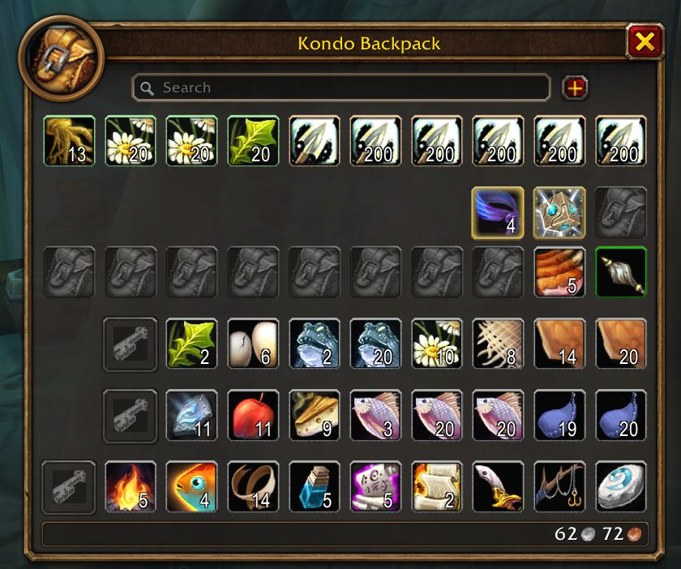
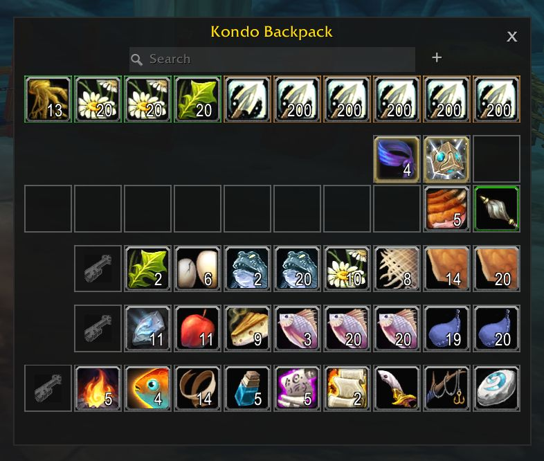

# KondoBags

| Classic theme | Modern theme |
|---|---|
|  |  |

A backpack for World of Warcraft that lets you organize your items neatly, the way you would in the real world — or at least the way Marie Kondo would.

## The idea

Most bag addons organize *for* you: they sort by category, by quality, by rules you write and then forget. KondoBags does the opposite. It keeps the one backpack you already know — the stock Classic grid, same art, same loot order — and gives you **better tools to tidy it yourself**. Nothing moves unless you move it. There are no rules to write and no automation to fight. What you put somewhere stays there.

The window is the stock bag plus **Keep**:

- **Incoming** — everything you loot, drawn exactly where the stock bag would draw it. New loot fills the next free cell; nothing already there moves.
- **Keep** — one or more rows at the bottom, each led by a lock cell. Drop an item on a lock to keep it; drag it back up to let it go; hold **Shift** while dragging to choose its exact spot. Your Hearthstone starts there.

The `+` button next to the search box adds another Keep row; right-click a lock to remove one. Everything the addon remembers about how you sort is **per character**, so each character's backpack is its own.

## What you get

- **Replaces the stock bags.** `B`, the bag-bar buttons, vendors, mail, bank and auction house all open KondoBags; the Blizzard bag windows never show. No option to run both — disable the addon to get the stock bags back.
- **Special bags in their own row.** Quiver, ammo pouch, herb, soul, enchanting, mining and other profession bags are drawn as one row above your items, with a colour tint per bag type. Empty cells show the equipped bag's own icon (or the item-type art, your choice).
- **Drop guidance.** While you carry an item, special-bag cells that will not take it show a circle-X; occupied ones dim. General cells accept anything and are never marked.
- **Quest items stand out.** Quest items get the stock yellow border (and the `!` for quest starters), gently pulsing so they catch the eye — on Classic Era too, where the stock bags hide it.
- **Search** that dims everything but the match.
- **Two themes.** *Classic* is the stock backpack look of whatever client you are on; *Modern* is a flat dark panel with square cells. Same grid, same Keep.
- **Edit Mode.** Position, scale and column count live in Blizzard's Edit Mode (drag the frame; drag its corner grip to set columns). The window opens where the stock bags open on a fresh install.
- **Combat-safe.** Item cells are Blizzard's own secure buttons, so right-click to use, drag, split, sell and trade all work in combat exactly as they do in the stock bags.

## Settings

Kept deliberately short. `Esc` › Options › AddOns › **Kondo Bags**, or `/kondo options`.

| Setting | Where |
|---|---|
| Theme: Classic / Modern | Settings |
| Tint special-bag slots by bag type | Settings |
| Empty special-bag slots show the equipped bag's icon / item-type art | Settings |
| Lock window position | Settings and the Edit Mode dialog |
| Window position, scale, columns | Edit Mode |
| Reset all settings (with confirm) | Settings, or `/kondo reset` |

`/kondo` toggles the window. `/kondo status` prints version, provider and a summary of your bags.

## Clients

Classic Era / Hardcore and WoW: Forever are the tested targets. Other flavours are listed in the TOC and share the same code through a per-client provider layer; they are untested until noted in the changelog.

## Status

Alpha, in daily use by the author on Forever. See [`SPECS/00_KondoBags_Core.md`](SPECS/00_KondoBags_Core.md) for the design and [`SPECS/01_Stock_Bag_Replacement.md`](SPECS/01_Stock_Bag_Replacement.md) for how the stock bags are replaced. Bank support is planned; nothing here touches the bank yet.

## Repository layout

```
KondoBags/            the addon (what gets installed)
SPECS/                design specs
Assets/               screenshots for this README
docs/                 notes and screenshots
spec/                 off-client tests, run with  lua5.1 spec/run.lua
```

## License

MIT. Bundled libraries keep their own licences in `KondoBags/Libs/*`.